# Sign Builder: Saudi Edition

An extended edition of [Sign Builder](https://github.com/andyjsmith/CS2-SignBuilder) by **Andy Smith** for Cities: Skylines II: design road signs in game and place them on gantries, posts or any surface. This edition adds new tools, reworks how right-to-left text is laid out on signs, and brings a complete Saudi theme. Every feature of the original is kept.

[العربية](#بناء-اللوحات-النسخة-السعودية)

## Screenshots · الصور

<p align="center">
  <a href="SignBuilder/Properties/SA-Screenshot1.png">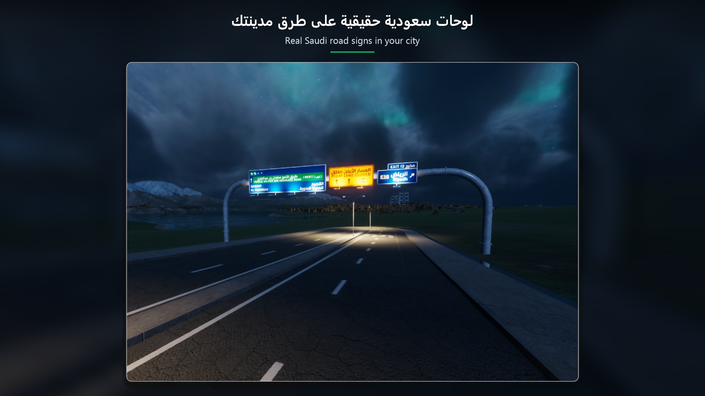</a>
  <a href="SignBuilder/Properties/SA-Screenshot2.png">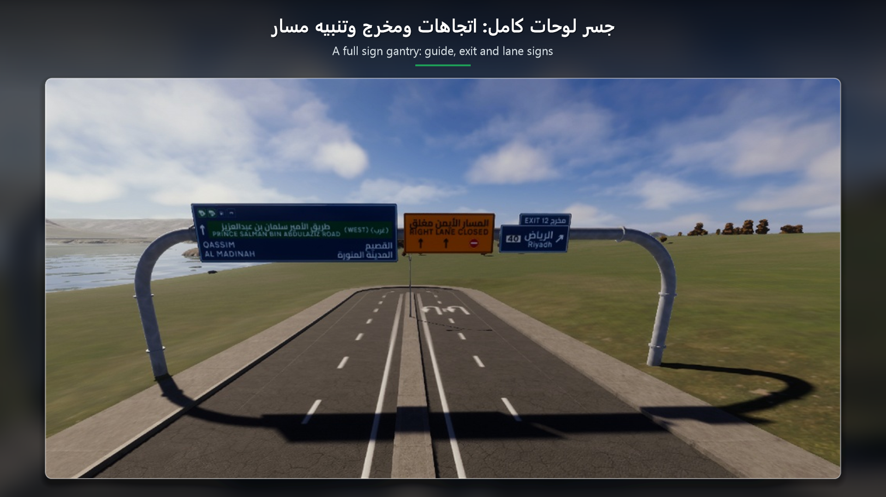</a>
  <a href="SignBuilder/Properties/SA-Screenshot3.png">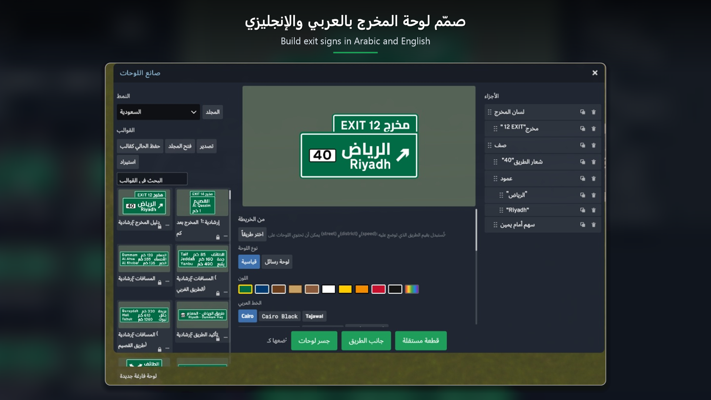</a>
  <a href="SignBuilder/Properties/SA-Screenshot4.png">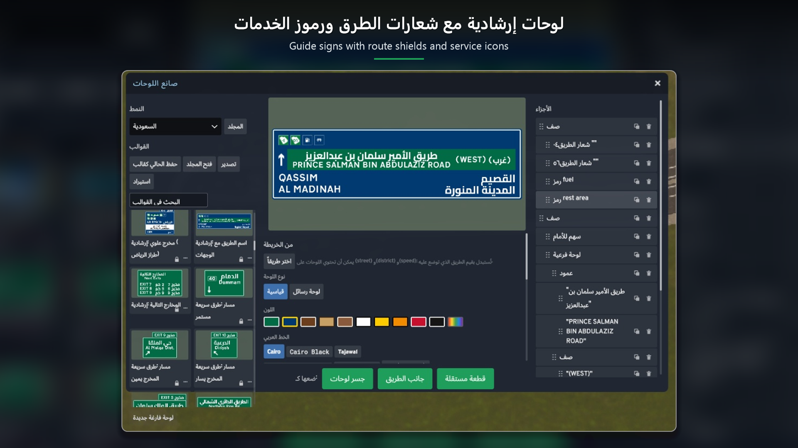</a>
  <a href="SignBuilder/Properties/SA-Screenshot5.png">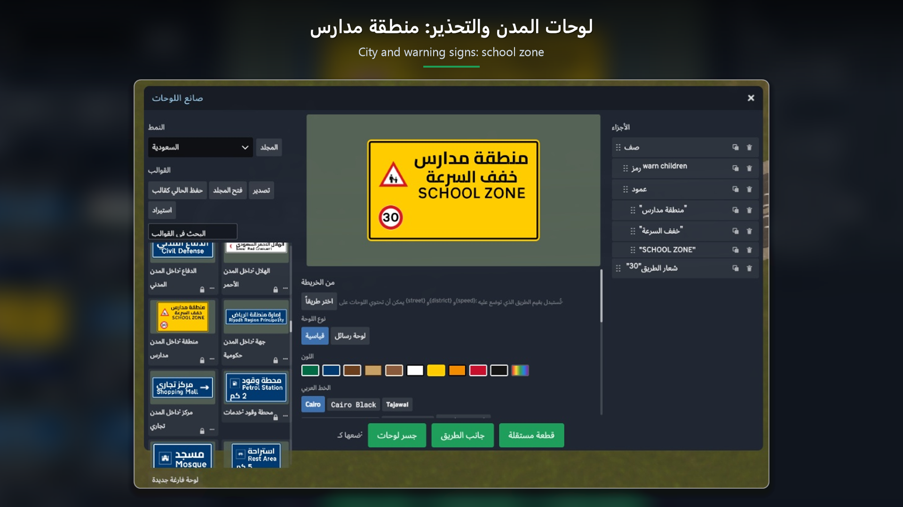</a>
  <a href="SignBuilder/Properties/SA-Screenshot6.png">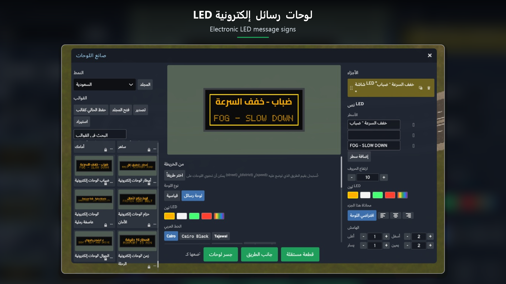</a>
  <a href="SignBuilder/Properties/SA-Screenshot7.png">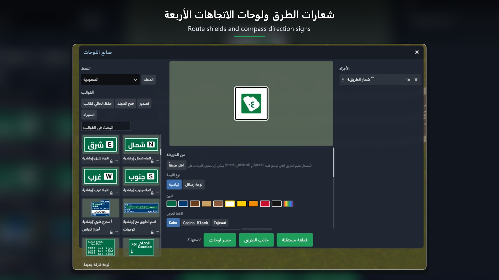</a>
  <a href="SignBuilder/Properties/SA-Screenshot8.png">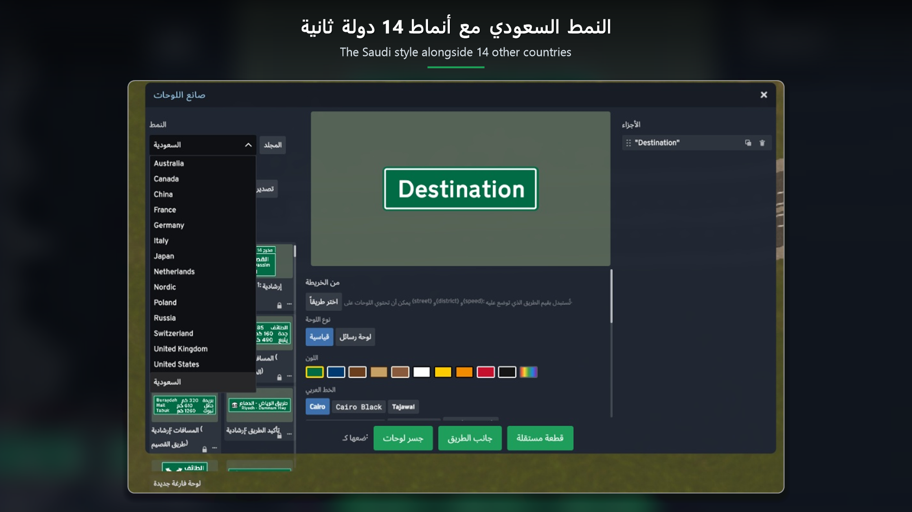</a>
  <a href="SignBuilder/Properties/SA-Screenshot9.png">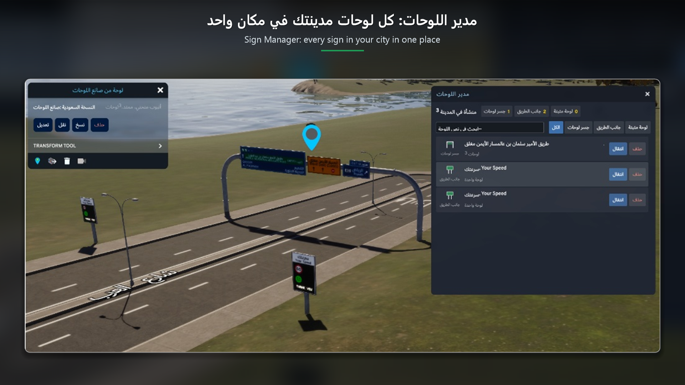</a>
  <a href="SignBuilder/Properties/SA-Screenshot10.png">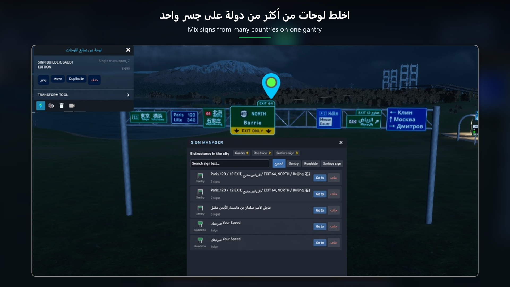</a>
  <a href="SignBuilder/Properties/SA-Screenshot11.png">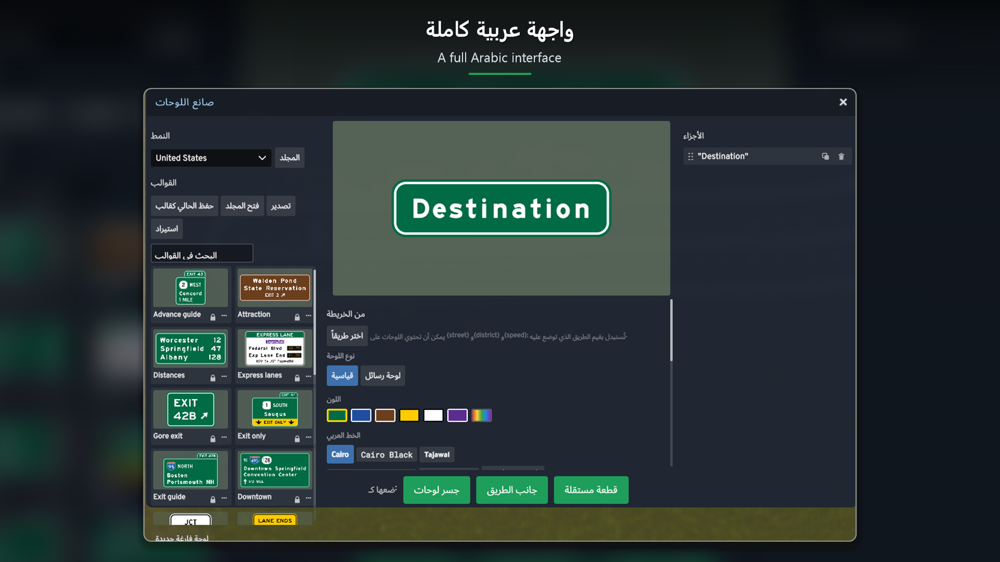</a>
</p>

## What's new compared to the original
**New tools**
- Sign manager: every sign in the city in one searchable list (jump to it, delete it).
- Pick a road: street, district and speed limit read from the map, with live `{street}`, `{district}` and `{speed}` placeholders and template suggestions per road class.
- "Your Speed" signs that switch between a happy and a sad face from the speed of passing traffic.
- LED glow that follows night, fog and rain.
- Template packs: export and import designs.
- Line spacing and part spacing controls.
- Interface language option (Auto / Arabic / English), applied at once.
- Delete a sign from its info panel.

**Improvements**
- Right-to-left text layout: connected Arabic letters (shaping), correct order in lines mixing Arabic, Latin and numbers (run-level bidi), no overlap between scripts, no unwanted wrapping, extra room above and below Arabic lines.
- Arabic fonts: Cairo, Cairo Black, Tajawal, Tajawal ExtraBold, Amiri.
- "Saudi Arabia" theme: 131 templates in 10 categories, Saudi route shields, and a 56-pictogram symbol library.
- Full Arabic interface.
- Fully independent from the original (own assembly, mod id, data folder, settings, prefab names, binding groups and CSS class prefix), so both can be installed side by side.

## Repository layout
| Path | What |
|---|---|
| `SignBuilder/` | The mod: C# (`SignBuilderSA.csproj`), the React UI (`UI/`), the sign renderer (`Resources/Renderer/renderer.js`), themes and symbol libraries (`Resources/`). |
| `SignBuilder/Resources/Themes/sa/` | The Saudi theme (templates and shields). |
| `SignBuilder/Resources/Symbols/sa/` | The Saudi symbol library and its `CREDITS.txt`. |
| `SignBuilder/Properties/` | Paradox Mods publishing files. |
| `ThemeTemplate/` | How to make your own theme pack (from the original). |
| `DEVELOPING.md`, `README-SignBuilder-original.md` | The original project's developer notes and full user guide. |
| `README-PUBLISH.md` | Publishing steps for this edition. |

## Building
Requirements: Cities: Skylines II with the official modding toolchain installed (it sets the `CSII_*` environment variables), .NET SDK, Node.js 18+.

```
cd SignBuilder/UI
npm install
cd ..
dotnet build SignBuilderSA.csproj -c Release
```

The build compiles the C# and the UI and deploys the mod to the game's local `Mods/SignBuilderSA` folder. Close the game first (it locks the files).

## Credits and licenses
- Original mod: **Sign Builder** by **Andy Smith**, https://github.com/andyjsmith/CS2-SignBuilder (MIT). Huge thanks for the original work.
- This edition: MIT, see [LICENSE](LICENSE) (both copyright lines).
- Arabic fonts Cairo, Tajawal and Amiri: SIL Open Font License, see `SignBuilder/Resources/Fonts/OFL-*.txt`. Other theme fonts: see the licence file next to each.
- Pictograms: Material Design Icons (Apache 2.0), camel from game-icons.net (CC BY 3.0), Temaki and Maki (CC0). Details in `SignBuilder/Resources/Symbols/sa/CREDITS.txt`.

---

# بناء اللوحات: النسخة السعودية

نسخة مطوّرة من [Sign Builder](https://github.com/andyjsmith/CS2-SignBuilder) للمطوّر **Andy Smith** للعبة Cities: Skylines II: صمّم لوحات الطرق داخل اللعبة وركّبها على الجسور والأعمدة وأي سطح. هذي النسخة تضيف أدوات جديدة، وتعيد بناء طريقة كتابة النصوص من اليمين لليسار على اللوحات، وفيها نمط سعودي متكامل. كل ميزات الأصلي باقية.

## وش الجديد مقارنة بالأصلي
**أدوات جديدة**
- مدير اللوحات: كل لوحات المدينة في قائمة وحدة مع بحث وانتقال وحذف.
- اختيار الطريق: اسم الشارع والحي وحد السرعة من الخريطة، مع المتغيرات `{street}` و `{district}` و `{speed}` واقتراح قوالب حسب نوع الطريق.
- لوحات "سرعتك" تتحول بين وجه مبتسم وحزين حسب سرعة السيارات المارّة.
- توهّج LED حسب الليل والضباب والمطر.
- حزم القوالب: تصدير واستيراد التصاميم.
- التحكم في تباعد الأسطر والتباعد بين الأجزاء.
- خيار لغة الواجهة (تلقائي / العربية / الإنجليزية) يتطبق فوراً.
- حذف اللوحة من لوحة معلوماتها.

**تحسينات**
- كتابة من اليمين لليسار: حروف عربية متصلة، وترتيب صحيح في السطور اللي تجمع العربي والإنجليزي والأرقام، بدون تداخل ولا انقسام سطر بالغلط، ومسافة إضافية فوق وتحت السطر العربي.
- خطوط عربية: Cairo و Cairo Black و Tajawal و Tajawal ExtraBold و Amiri.
- نمط "السعودية": 131 قالباً في 10 فئات، دروع الطرق السعودية، ومكتبة 56 رمزاً.
- واجهة عربية كاملة.
- مستقل تماماً عن الأصلي، فتقدر تثبّت الاثنين مع بعض.

## البناء
تحتاج: اللعبة مع أدوات التعديل الرسمية (تضبط متغيرات `CSII_*`)، و .NET SDK، و Node.js 18 أو أحدث.

```
cd SignBuilder/UI
npm install
cd ..
dotnet build SignBuilderSA.csproj -c Release
```

البناء يجمّع الكود والواجهة وينسخ المود لمجلد `Mods/SignBuilderSA` في اللعبة. اقفل اللعبة قبل البناء.

## الشكر والتراخيص
- المود الأصلي: **Sign Builder** من **Andy Smith**، https://github.com/andyjsmith/CS2-SignBuilder (رخصة MIT). شكراً جزيلاً له.
- هذي النسخة: رخصة MIT، انظر [LICENSE](LICENSE).
- الخطوط العربية Cairo و Tajawal و Amiri برخصة SIL OFL، والرموز حقوقها في `SignBuilder/Resources/Symbols/sa/CREDITS.txt`.
